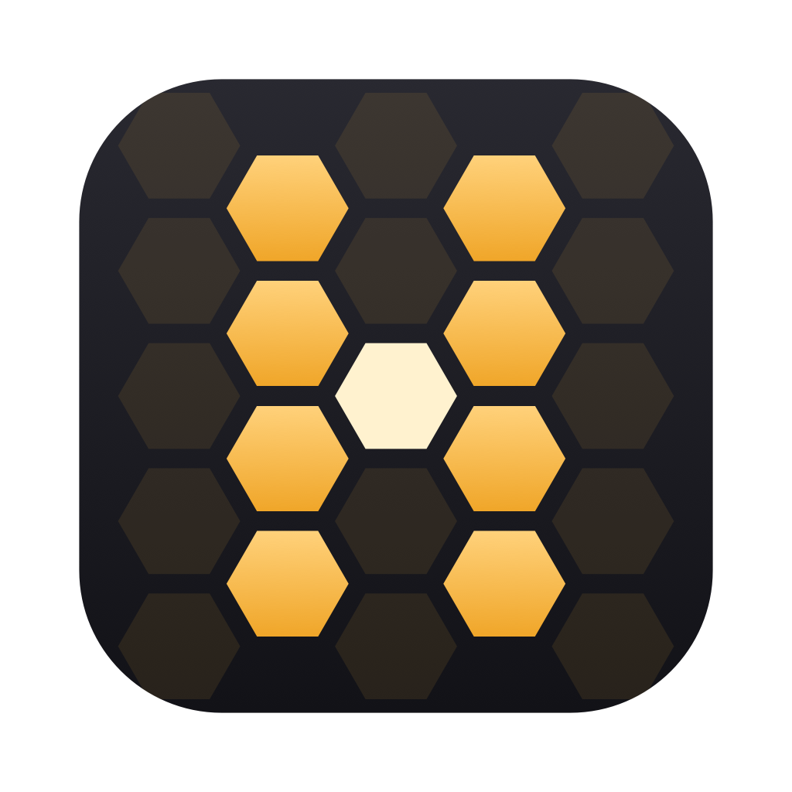

# Havebee



**Your projects. Your agents. One hive.**

A native macOS workspace for AI coding agents. Keep projects, Git worktrees and
conversations together, with a real terminal for Claude Code, Codex, Gemini, Grok
or your shell.

Free and open source under [GPL-3.0-only](LICENSE). Created and maintained by
Luciano Sánchez. Contributions are welcome; the maintainer reviews changes and
publishes the official versions.

[Guía completa en español](docs/README.es.md) · [Contributing](CONTRIBUTING.md) ·
[Governance](GOVERNANCE.md) · [Security](SECURITY.md)

Canonical repository: [github.com/Lucsnchz/havebee](https://github.com/Lucsnchz/havebee).

## What it does

- **Projects → branches → sessions.** Work on several branches at once without
  mixing their terminals, commands or conversations.
- **Keep the conversation.** Claude and Codex can hand a conversation to each
  other, with a shared history and recovery of interrupted sessions and drafts.
- **See what needs you.** Session status, notifications, usage indicators and
  keyboard navigation help you find agents waiting for input.
- **Prepare Laravel worktrees.** Copy local environment files, install Composer
  and frontend dependencies, build assets and configure a separate Herd site.
  Review the setup before running it; database migrations are not automatic.
- **Handle Git in context.** See existing branches, create worktrees, review
  diffs and open pull requests or merge requests on the repository's host.
- **Remove worktrees deliberately.** Review uncommitted changes and unmerged
  commits, and choose separately whether to remove the local branch.
- **Use your existing tools.** Project commands and MCP configuration stay tied
  to the worktree. AI CLIs are installed separately and use your own accounts.

The application is early-stage software. Its interface and detailed user guide
are currently in Spanish. Provider subscriptions and API charges are separate
from this free application.

## Build and run

Requirements:

- macOS 14 or later to run the app.
- Xcode with **Swift 6.2 or later** to build the pinned dependencies. The macOS
  version needed to run Xcode may be newer than the app's minimum version.
- Git. Install and authenticate any AI CLI you want to use separately.
- For Laravel setup: PHP, Composer and the project's frontend package manager;
  Laravel Herd is optional.

Clone the repository and build the app:

```bash
git clone https://github.com/Lucsnchz/havebee.git
cd havebee
scripts/build-app.sh
open build/Havebee.app
```

The app installs as **Havebee.app**. Its bundle identifier
(`com.lucianosanchez.hive`) and local data folder (`~/Library/Application Support/Hive`)
keep the original **Hive** name, so settings, sessions and history carry over
from older builds without migration.

To install the build, quit the running app first:

```bash
scripts/build-app.sh --install
```

This produces a locally signed development build, not an Apple-notarized
download. The build script includes the project and third-party license notices
inside the app bundle. Build with the checked-in `Package.resolved`.

## Development

```bash
scripts/test.sh                         # complete test suite
scripts/test.sh HiveCoreTests           # core tests only
scripts/test.sh --snapshots /tmp/hive-ui # tests and rendered UI snapshots
```

The tests use temporary projects and fake agent processes. UI tests need macOS
and a graphical login session. The [GitHub Actions workflow](.github/workflows/ci.yml)
runs the tests and builds the app on a hosted macOS runner.

To keep development app data separate from your normal workspace:

```bash
HIVE_HOME="$(mktemp -d)" swift run Hive
```

`HIVE_HOME` isolates this app's state and history; it does not isolate agent
accounts or their own configuration. Use disposable projects when testing
worktree setup, MCP edits or commands that modify files.

The package has three modules:

| Module | Responsibility |
| --- | --- |
| `HiveCore` | Models, Git, history, agent events and worktree preparation |
| `HiveKit` | SwiftUI/AppKit interface, terminal and application coordination |
| `Hive` | Application entry point |

Dependencies flow from `Hive` to `HiveKit` to `HiveCore`. See the
[Spanish architecture guide](docs/README.es.md#arquitectura) for details.

## Contribute

Start with an issue for substantial changes. Fork the repository, create a
branch and submit a pull request with the problem, solution and validation.
Read [CONTRIBUTING.md](CONTRIBUTING.md) for the Developer Certificate of Origin
and contribution requirements. See [GOVERNANCE.md](GOVERNANCE.md) for who decides
what is merged and released.

Do not put credentials, private conversations or customer data into issues,
pull requests, logs or screenshots. Report vulnerabilities using
[SECURITY.md](SECURITY.md).

## License and attribution

Copyright © 2026 Luciano Sánchez and contributors.

Original project code and documentation are licensed under the GNU General
Public License, **version 3 only** (`GPL-3.0-only`). You may use, modify and
redistribute the software, including commercially, under that license. It comes
without warranty; see [LICENSE](LICENSE) for the complete terms.

Third-party components retain their own licenses, listed in
[THIRD_PARTY_NOTICES.md](THIRD_PARTY_NOTICES.md) and [LICENSES](LICENSES).
The source license does not grant trademark rights; see
[TRADEMARKS.md](TRADEMARKS.md). This is an independent project, not an official
product of Anthropic, OpenAI, Google, xAI or Laravel.
